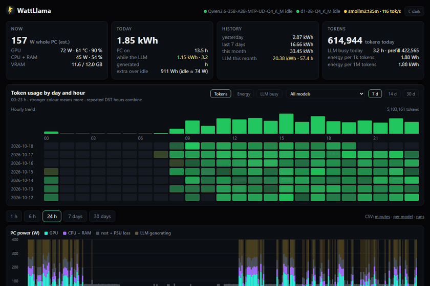
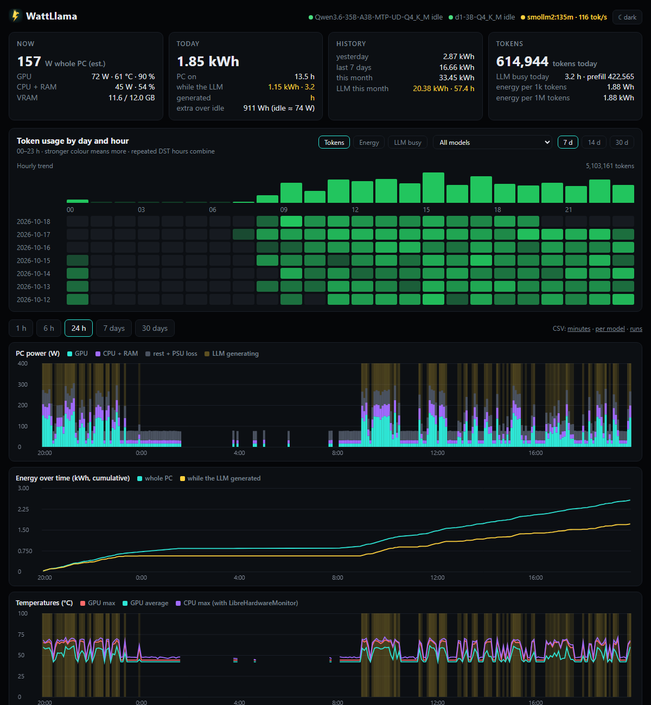
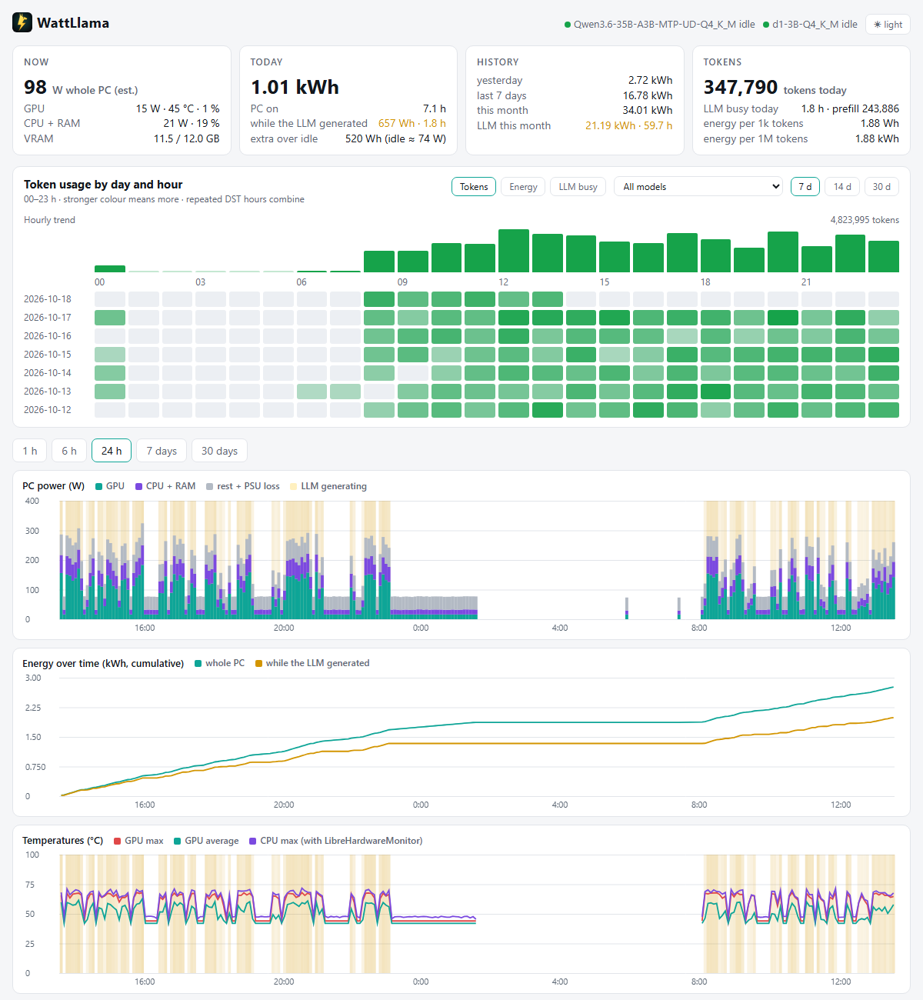
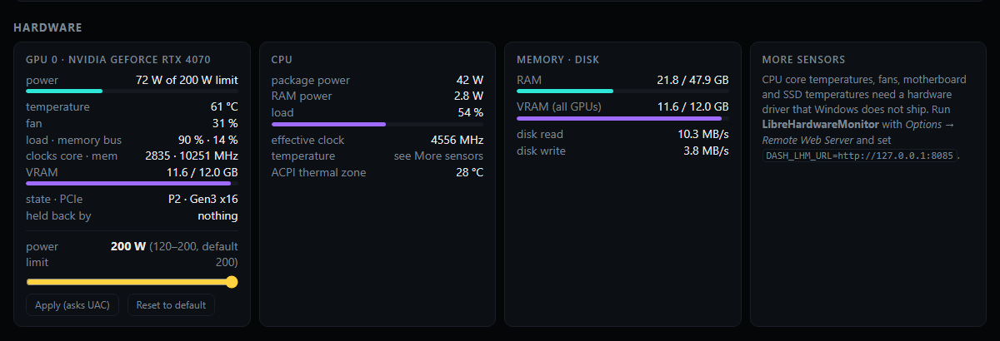
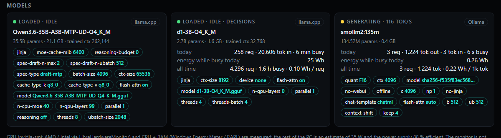
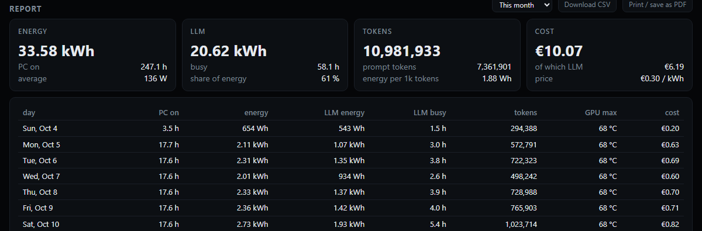
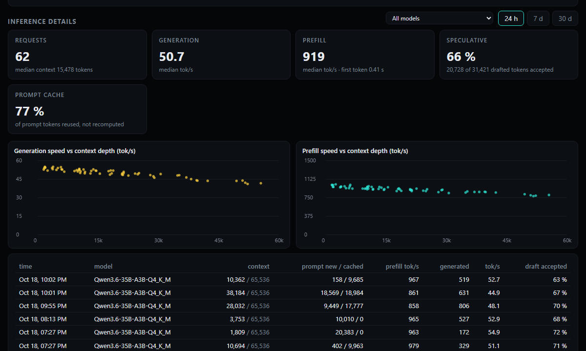
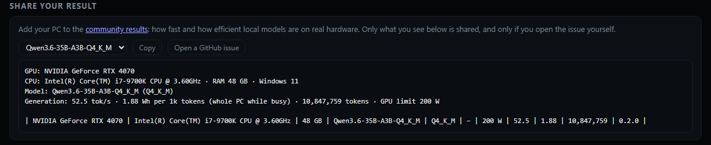

<p align="center">
  
</p>

<h1 align="center">WattLlama</h1>

<p align="center">
  <b>How many watts does your local LLM really burn?</b><br>
  A live power, temperature and energy-per-token dashboard for <b>Windows and Linux</b> PCs running
  <b>llama.cpp</b>, <b>Ollama</b> or <b>LM Studio</b>.<br>
  No drivers, no admin rights, no Docker, no npm packages. One small Node.js process.
</p>

<p align="center">
  <a href="https://github.com/depthark/wattllama/actions/workflows/ci.yml"></a>
  
  
  
  
  
  
</p>



## Why

Running models locally is "free" until you look at what the PC draws while it thinks.
WattLlama answers the questions a local-LLM user actually has:

- **What does my PC draw right now?** GPU, CPU and RAM measured, the rest estimated, split in a stacked chart.
- **How much energy did today / this week / this month take, and how much of it was the LLM?**
  Every minute is stored, and minutes in which a model was generating are marked.
- **What does a token cost in energy?** Wh per 1,000 tokens and kWh per million, per model and per run.
- **When do I use it?** A day × hour heatmap of tokens, energy or busy time, like GitHub's contribution graph.
- **Is my GPU power limit costing me speed?** Generate at different limits and the efficiency table
  shows tokens per second and tokens per Wh for each, the "same speed for 100 W less" check
  from GPU undervolting videos, but for LLM inference.
- **How does my PC compare?** Share your numbers in one click to the [community results](RESULTS.md).

It does not matter which chat app, agent or IDE plugin you use: WattLlama watches the **engine**,
so every client that talks to it is counted.

## Features

| | |
|---|---|
| ⚡ **Power** | Whole-PC watts (GPU, CPU package, RAM measured; rest + PSU loss estimated), history from 1 hour to 30 days, cumulative energy curve |
| 🦙 **Every model separately** | llama.cpp (server or router), Ollama and LM Studio, several models and engines at once: live state, tok/s, requests, tokens in/out, busy time, energy while busy |
| 🔬 **Inference details** | Per request: generation and prefill speed against context depth, time to first token, speculative-decoding (MTP / draft) acceptance, prompt-cache reuse; live context use per slot |
| 🔥 **Heatmap** | Day × hour grid of tokens, energy or busy time for all models or one, 7 / 14 / 30 days |
| 🌡️ **Hardware** | NVIDIA: temperature, fan, clocks, VRAM, P-state, PCIe link, *why it is throttled*. CPU load, effective clock, RAM, disk I/O. With [LibreHardwareMonitor](https://github.com/LibreHardwareMonitor/LibreHardwareMonitor) (optional): CPU core temperatures, fans, SSDs, and **AMD Radeon / Intel Arc** GPU power |
| 🎚️ **GPU power limit** | Optional: set the NVIDIA power limit from the page (UAC-confirmed, safe range) and compare efficiency per limit |
| 📋 **Runs** | One row per generation run: model, duration, requests, tokens, tok/s, Wh, Wh per 1k tokens |
| 🏆 **Community results** | Turn your numbers into a prefilled GitHub issue for [RESULTS.md](RESULTS.md); you see exactly what is shared |
| ⚙️ **Setup at a glance** | The real arguments each model runs with (secrets masked), [pi](https://github.com/badlogic/pi-mono) agent settings if you use it, chosen Windows scheduled tasks with last/next run |
| 🔔 **Alerts** | GPU / CPU too hot, GPU throttling, VRAM full, an engine stopped, a model stuck generating, daily kWh or cost budget: on the page, as browser notifications, and optionally on your phone (Discord, ntfy, Slack, any webhook) |
| 🧾 **Reports** | This month, last month, last 7 / 30 days, this or last year: per day and per model, as CSV or print / PDF |
| 💶 **Cost (optional)** | Set your price per kWh and currency to see money next to every kWh; off by default |
| 📤 **CSV export** | Minutes, per-model minutes and runs, for your own spreadsheets |
| 🐧 **Windows and Linux** | Same page, same numbers; on Linux the sensors (CPU temperatures, fans, AMD / Intel GPUs) need no extra software |
| 🌓 **Light & dark** | Follows the system, or pick one |
| 🪶 **Featherweight** | Measured: **0.02 % CPU, ~150 MB RAM** in total; generation speed unchanged (54–60 tok/s with and without it) |

<details>
<summary>Screenshots</summary>









</details>

## Install

Requirements: [Git](https://git-scm.com) and [Node.js](https://nodejs.org) 22.13 or newer
(`node --version` to check). A GPU and an inference engine are optional; without them you get CPU and
system power only.

**Windows** 10 (1809+) or 11 (`winget install OpenJS.NodeJS.LTS` for Node.js):

```powershell
git clone https://github.com/depthark/wattllama
cd wattllama
powershell -ExecutionPolicy Bypass -File .\install.ps1
```

**Linux** with systemd (Ubuntu, Debian, Fedora, Arch, …; Node.js from your distribution if it is new
enough, [nodejs.org](https://nodejs.org) or nvm):

```bash
git clone https://github.com/depthark/wattllama
cd wattllama
./install.sh            # add --rapl to measure CPU + RAM power, see below
```

The installer checks what your PC can measure and which engines are running, creates `.env`,
and makes WattLlama start when you log in, as your own user: a scheduled task on Windows, a systemd
user service on Linux (`journalctl --user -u wattllama` for its log). Then it opens
**http://127.0.0.1:8091**.

Just want to look first? `node server.mjs --demo` serves the page with 14 days of sample history
(in memory, nothing saved).

### Update

```powershell
# Windows, in the wattllama folder
git pull
Stop-ScheduledTask WattLlama; Start-ScheduledTask WattLlama
```

```bash
# Linux, in the wattllama folder
git pull && ./install.sh --no-open
```

Your `.env` and history stay as they are. New settings are optional; `.env.example` lists them all.

### Uninstall

`.\uninstall.ps1` on Windows, `./uninstall.sh` on Linux. It removes the autostart, the firewall rule
and (Linux) the RAPL helper. Your history in `data/` is kept unless you add `-RemoveData` /
`--remove-data`; then delete the folder.

### Troubleshooting

| Problem | What to do |
|---|---|
| Page does not open | Is it running? Windows: `Get-ScheduledTask WattLlama`, log in `data\wattllama.log`. Linux: `systemctl --user status wattllama`, `journalctl --user -u wattllama` |
| "port 8091 is in use" in the log | Set another `DASH_PORT` in `.env` and restart |
| CPU power says "(est.)" | Windows exposes no Energy Meter on this CPU, or on Linux the `--rapl` helper is not installed. Set `DASH_CPU_MAX_W` to your CPU's power for a better estimate |
| No GPU card | NVIDIA: is `nvidia-smi` on the PATH? AMD / Intel: Linux reads them itself; on Windows run LibreHardwareMonitor |
| No models or tokens | Is the engine running on its default port? See [Connect your engine](#connect-your-engine); the page shows a note when counts are limited |
| Settings have no effect | Restart WattLlama after editing `.env`. If a setting appears twice, the last line wins |

### Linux: CPU and RAM power (`--rapl`)

CPU package and RAM watts come from the CPU's RAPL energy counters. Since Linux 5.10 only root may read
them, because reading them thousands of times a second can leak secrets through power side channels
([CVE-2020-8694](https://platypusattack.com/)). WattLlama never runs as root. Instead,
`./install.sh --rapl` (asks for sudo once) installs a tiny root helper that publishes a **2-second
average rounded to 0.1 W** in `/run/wattllama/rapl`, far too coarse for that attack and all WattLlama
needs. It runs under a locked-down systemd unit: no capabilities, no network, read-only system,
system-call filter (`systemd-analyze security` rates it 1.0, "OK"). Without it, CPU power is
estimated from load and marked "(est.)". `./uninstall.sh` removes it.

## Connect your engine

All three are found automatically on their default ports. An engine that is not running costs
nothing; it is asked again every 10 s and appears when you start it.

| Engine | Found at | Tokens | Generating now |
|---|---|---|---|
| **llama.cpp** `llama-server`, router too | `DASH_LLAMA_URL` (:8080) | exact from its log (`DASH_LLAMA_LOG`) or `--metrics`; else `/slots` (close) | `/slots` |
| **Ollama** (the app, the service or `ollama serve`) | `OLLAMA_HOST` or :11434 | exact from its log (Windows: `server.log`, Linux: the systemd journal); else `/slots` (close) | the model's llama-server `/slots` |
| **LM Studio** (Developer → Start server) | `DASH_LMSTUDIO_URL` (:1234) | exact, LM Studio's own stats via `lms log stream` | each prediction's exact duration, counted when it ends |

<details>
<summary>Details per engine</summary>

**llama.cpp.** Works with a single `llama-server` and with the router (`--models-dir` /
`--models-preset`) with any number of loaded models. For exact counts, redirect the server's output
to a file and point `DASH_LLAMA_LOG` at it, or start it with `--metrics`. If it uses `--api-key`,
set `DASH_LLAMA_API_KEY`. WattLlama never asks the router about a model that is not loaded, because
that would load it.

**Ollama.** Recent Ollama (tested with 0.40.6) runs each model as an upstream llama-server process and writes its
output to its log, which gives the same exact counts: `%LOCALAPPDATA%\Ollama\server.log` on Windows, the
`ollama` service's journal on Linux. Reading the journal needs your user in the `systemd-journal` group
(`sudo usermod -aG systemd-journal $USER`, then log in again); without it, counts come from `/slots`
and the page says so. The **prefill** column counts tokens that
were actually computed; prompt-cache hits are not counted (Ollama's `prompt_eval_count` includes them).
Models served by another Ollama runner show as loaded, without token counts.

**LM Studio.** Token counts need the `lms` CLI, which LM Studio installs in
`~/.lmstudio/bin` (`%USERPROFILE%\.lmstudio\bin` on Windows). WattLlama starts `lms log stream` only while the server answers and
always with an explicit port, so it never launches LM Studio. Prompts and replies pass through that
stream; WattLlama reads only the model name and the numbers, and never stores, logs or shows text.
LM Studio reports a prediction only when it is finished, so its busy time is counted from its exact
duration at that moment, and the page shows it as idle while it generates. Tested with llmster 0.0.25.

**Something else?** vLLM, KoboldCpp, llama-swap, Jan, … An adapter is one file:
see [CONTRIBUTING.md](CONTRIBUTING.md#adding-an-engine).

</details>

### Alerts

On by default with sensible limits, shown on the page; change or turn off each rule in `.env`:

| Alert | Default | |
|---|---|---|
| GPU / CPU temperature | 83 °C / 90 °C for a minute | critical 7 °C above |
| GPU throttling | on | heat or hardware slowdown for a minute, not the normal power cap |
| VRAM full | 99 % for a minute | past that, models spill into system RAM and slow down a lot |
| Engine stopped | on | an engine that was running does not answer for 2 minutes; "back to normal" when it returns |
| Busy too long | 60 min | one model generating without a pause: a runaway generation or a stuck agent |
| Daily budget | off | `DASH_ALERT_DAILY_KWH` / `DASH_ALERT_DAILY_COST` |

**Browser notifications:** click *Enable browser notifications* in the Alerts section; they work while
the page is open in a tab (on 127.0.0.1; browsers allow them only on secure origins).

**On your phone:** set `DASH_ALERT_WEBHOOK` to a [Discord webhook](https://support.discord.com/hc/en-us/articles/228383668),
an [ntfy](https://ntfy.sh) topic URL (pick a long random topic name and subscribe in the ntfy app), a
Slack webhook or any URL that accepts JSON, restart, and run `node server.mjs --test-alert`. Messages
contain numbers and model names only, at most 20 an hour.

### Phone / other devices

```powershell
.\install.ps1 -AllowLan        # Windows
./install.sh --allow-lan      # Linux
```

Serves on your network, adds a firewall rule for private networks only (Windows Firewall, or ufw on
Linux; for firewalld the installer prints the command), and sets a random access token. It prints a link to open once on the phone. Handy because a browser tab on the same PC
uses some VRAM, which matters when the model fills the card.

### CPU temperatures, fans, SSDs, AMD and Intel GPUs

**Linux** reads all of them from the kernel (`/sys/class/hwmon`) with no extra software: CPU, NVMe and
motherboard temperatures, fans, and the power, load, VRAM and clocks of discrete AMD Radeon and Intel Arc
cards.

**Windows** has no driver-free way to read CPU core temperatures, or the power of AMD and Intel GPUs. Run
[LibreHardwareMonitor](https://github.com/LibreHardwareMonitor/LibreHardwareMonitor), enable
*Options → Remote Web Server → Run*, and set `DASH_LHM_URL=http://127.0.0.1:8085`. Every temperature
and fan it sees shows up, CPU temperature joins the history chart, and discrete Radeon and Arc cards
get a GPU card and count towards whole-PC watts. (Integrated graphics are already inside the CPU
package power.)

### GPU power limit

Off by default. With `DASH_ALLOW_POWER_LIMIT=1` each NVIDIA card gets a slider:

- only from the PC itself (not from the network), only from WattLlama's own page;
- only between **60 % of the card's default** and its maximum, inside the range NVIDIA's driver allows;
- the OS asks you every time: a **UAC prompt** on Windows, a **password prompt** (polkit) on Linux;
- it is a power cap, **not an undervolt**: it cannot make the PC unstable, worst case the card is slower;
- it **resets on reboot**.

Then run your usual prompts at a few limits and read the *Efficiency by GPU power limit* table.

On Linux the NVIDIA driver supports power limits as on Windows (what it does not support is
undervolting, which WattLlama never does). Some laptop GPUs have a fixed limit; then no slider is
shown. Under WSL the limit cannot be changed at all.

> **Linux status:** the request goes through `pkexec`, which needs a polkit agent in your desktop
> session. It is not yet confirmed on real hardware that this works from the background service; if
> the page answers "Cancelled in the password prompt", use `sudo nvidia-smi -pl <watts>` meanwhile and
> tell us in [#5](https://github.com/depthark/wattllama/issues/5).

## How it measures

| What | Source | Accuracy |
|---|---|---|
| NVIDIA GPU power, temperature, clocks, VRAM, throttle reasons | `nvidia-smi` streaming every 2 s, one process | measured |
| AMD / Intel Arc GPU power, temperature, load, VRAM | Linux: hwmon. Windows: LibreHardwareMonitor (optional) | measured |
| CPU package and RAM power | RAPL energy counters. Windows: *Energy Meter* performance counters where Windows exposes them (most Intel desktop CPUs), read through the PDH API with English counter names, so any display language works. Linux: powercap, through the `--rapl` helper | measured |
| CPU load, effective clock, disk I/O, ACPI zone | Windows performance counters / Linux `/proc` and `/sys`, read in-process | measured |
| CPU, SSD, motherboard temperatures, fans | Linux: hwmon. Windows: LibreHardwareMonitor (optional) | measured |
| Rest of the PC (motherboard, disks, fans) | `DASH_REST_W` (35 W) | estimate |
| Power supply loss | divided by `DASH_PSU_EFF` (0.88) | estimate |
| Monitor | not counted | |
| CPU power on PCs without RAPL counters | from load × `DASH_CPU_MAX_W` | estimate, marked "(est.)" |
| Tokens, requests, generating or not | the engine, see [Connect your engine](#connect-your-engine) | exact or close |

For exact wall-socket numbers, nothing beats a smart plug with energy metering; WattLlama tells you
*where* the watts go and how much of it the LLM caused.

History lives in `data/power.db` (SQLite, built into Node.js): one row per minute, roughly 5–7 MB a
month. Export it as CSV from the links next to the chart ranges, or as a report per day and per model
(CSV, or *Print / save as PDF*) from the Report section.

## Compared with popular tools

| | LLM tokens & energy per token | Power history (kWh) | GPU + CPU sensors | Runs without admin / root | Setup |
|---|---|---|---|---|---|
| **WattLlama** (Windows + Linux) | ✅ per model, per run, 3 engines | ✅ | ✅ (Windows: + LHM) | ✅ | one script |
| [MSI Afterburner](https://www.msi.com/Landing/afterburner/graphics-cards) | ❌ | ❌ (log file) | ✅ GPU | admin | GUI app |
| [HWiNFO](https://www.hwinfo.com) | ❌ | ❌ (CSV log) | ✅ | admin driver | GUI app |
| [LibreHardwareMonitor](https://github.com/LibreHardwareMonitor/LibreHardwareMonitor) | ❌ | ❌ | ✅ | admin driver | GUI app (WattLlama can read it) |
| [nvitop](https://github.com/XuehaiPan/nvitop) / [nvtop](https://github.com/Syllo/nvtop) | ❌ | ❌ | GPU only | nvitop yes / nvtop Linux | terminal |
| [btop](https://github.com/aristocratos/btop) / [Glances](https://github.com/nicolargo/glances) | ❌ | ❌ | ✅ | partly | terminal / web |
| [Beszel](https://github.com/henrygd/beszel) | ❌ | ✅ | ✅ | agent | hub + agent |
| Grafana + exporters | with work | ✅ | ✅ | services | 3+ services |
| LM Studio / Ollama / llama.cpp UIs | tok/s per message | ❌ | ❌ | ✅ | built in |

Tools that also connect energy and tokens (checked against their own documentation, October 2026):

| | Energy per token | Counts | History | Engines | Platforms | Setup |
|---|---|---|---|---|---|---|
| **WattLlama** | ✅ Wh / 1k tokens, per model and run | **whole PC**: GPU + CPU + RAM measured, rest estimated | ✅ minutes, reports, heatmap | llama.cpp, Ollama, LM Studio | Windows, Linux | one script, no dependencies |
| [InferenceInquire](https://github.com/nisesen/llamacpp-dashboard) | ✅ Wh / 1k tokens, cost | GPU | ✅ 2 years, alerts | llama.cpp | agent on Linux (NVIDIA); dashboard in Docker anywhere | Docker Compose |
| [llmtop](https://github.com/ProgrammerPeasant/llmtop) | ✅ J / token, API-cost equivalent | GPU (NVML) | session | Ollama (llama.cpp planned) | Linux, Windows | `cargo install`, a proxy in front of Ollama |
| [otop](https://github.com/TiniLLM/ollama-token-monitor) | ❌ tok/s only | – | ❌ | Ollama | macOS (Apple GPU); Linux without GPU panel | Python, a proxy in front of Ollama |
| [MELODI](https://github.com/ejhusom/MELODI) | ✅ per prompt | GPU + CPU (RAPL, scaphandre) | experiment data | Ollama | Linux | research scripts |

If you run llama.cpp on a Linux GPU server, InferenceInquire is excellent, with alerts and deep
llama.cpp internals. WattLlama is for the PC you sit at: it counts the whole machine, not just the
GPU (with CPU-offloaded MoE experts, the CPU is a big part of the bill), follows three engines at
once, needs no Docker or proxy, and runs on Windows without admin rights.

WattLlama does not replace a hardware monitor; it connects the watts to the tokens.

## Security

WattLlama is a read-only monitor that runs as your user.

- Runs as your user, never as admin or root. On Linux the optional RAPL helper is the only root part:
  a short shell script under a locked-down unit that writes one file of coarse watts.
- Listens on **127.0.0.1** only, unless you choose `-AllowLan` / `--allow-lan` (then a random token is
  required, and `.env` is readable by you only).
- **No dependencies**: Node.js built-ins and the OS's own tools only, nothing to supply-chain.
- **GET only**, a fixed list of files (no path ever comes from the URL), strict
  **Content-Security-Policy**, `X-Frame-Options: DENY`, `nosniff`, no CORS.
- **DNS-rebinding protection**: requests whose `Host` is a foreign domain are refused, so a website
  you visit cannot read the dashboard through your browser.
- Never shows secrets: `--api-key` and similar arguments are masked, file paths are shortened to
  file names, pi's `auth.json` and API keys are never read, prompts and replies are never stored.
- Nothing is sent anywhere, with one opt-in exception: alerts go to `DASH_ALERT_WEBHOOK` if you set
  it (https only, numbers and model names only, the URL never shown or logged, at most 20 an hour,
  no redirects followed). *Share your result* only opens a GitHub page with what you saw.
- The single optional write action (GPU power limit) is described above: off by default, local
  only, same-origin with a custom header (blocks CSRF), range-checked, confirmed in the OS's own prompt.
- Crash-safe: an unexpected error is logged and the process restarts; it never touches drivers,
  clocks, fans or voltages.
- **The database** (`data/power.db`, SQLite) holds numbers and model names only, never prompts or
  text. `data/` and `.env` are readable by you only (Linux 0700 / 0600; on Windows the installer
  sets an ACL for you, SYSTEM and Administrators). The page reads through a separate **read-only**
  connection, so no request can change or delete data. WAL journal (crash-safe), an integrity check at
  start (a damaged file is moved aside, never overwritten), versioned migrations in one transaction,
  a **daily backup** in `data/backup/` (last 7 kept), alerts kept 365 days and per-request details 90.
- CI runs the HTTP security rules as tests on every change, on Windows and Linux, and fails if the
  RAPL helper's systemd hardening ever gets weaker.

See [SECURITY.md](SECURITY.md) for reporting.

## Configuration

Everything lives in `.env` (see [.env.example](.env.example)); all settings are optional.

| Setting | Default | |
|---|---|---|
| `DASH_HOST` / `DASH_PORT` | `127.0.0.1` / `8091` | where the page is served |
| `DASH_ENGINES` | `auto` | or a list, e.g. `ollama,lm studio` |
| `DASH_LLAMA_URL` | `http://127.0.0.1:8080` | llama.cpp server or router; empty = off |
| `DASH_LLAMA_LOG` | – | llama-server log file, for exact token counts |
| `DASH_LLAMA_API_KEY` | – | if the server uses `--api-key` |
| `DASH_OLLAMA_URL` | `OLLAMA_HOST` or `:11434` | empty = off |
| `DASH_OLLAMA_LOG` | Windows: `%LOCALAPPDATA%\Ollama\server.log` | Ollama's log file, for exact token counts |
| `DASH_OLLAMA_JOURNAL` / `DASH_OLLAMA_UNIT` | `1` / `ollama` | Linux: read the service's journal (`0` = off) |
| `DASH_LMSTUDIO_URL` | `http://127.0.0.1:1234` | empty = off |
| `DASH_LMSTUDIO_API_KEY` / `DASH_LMSTUDIO_LMS` | – / found | if the server requires a token / path to `lms` |
| `DASH_ALERTS`, `DASH_ALERT_*` | on, see [Alerts](#alerts) | alert rules; `DASH_ALERT_WEBHOOK` sends them to your phone |
| `DASH_PRICE_PER_KWH` / `DASH_CURRENCY` | – | optional cost: all-in price per kWh from your bill, e.g. `0.30` / `EUR` |
| `DASH_REST_W` / `DASH_PSU_EFF` | `35` / `0.88` | the estimated part |
| `DASH_CPU_MAX_W` | `65` | only used without RAPL counters |
| `DASH_LHM_URL` | – | LibreHardwareMonitor web server |
| `DASH_ALLOW_POWER_LIMIT` | `0` | NVIDIA power limit control |
| `DASH_TOKEN` | – | require a token (set by `-AllowLan`) |
| `DASH_TASKS` | – | Windows scheduled tasks or Linux systemd timers to show, e.g. `Backup*,MyLLM` |
| `DASH_PI_DIR` | `~/.pi/agent` | pi agent settings |

## Contributing

Help is very welcome, and much of it needs no code: **share a result** from your PC, or **report how
it measures** on an AMD / Intel GPU, an AMD CPU or a laptop. New engines are one file each.
Everything is in [CONTRIBUTING.md](CONTRIBUTING.md) (how the code works and its rules: [AGENTS.md](AGENTS.md)); look for
[`good first issue`](https://github.com/depthark/wattllama/labels/good%20first%20issue).

## License

MIT
